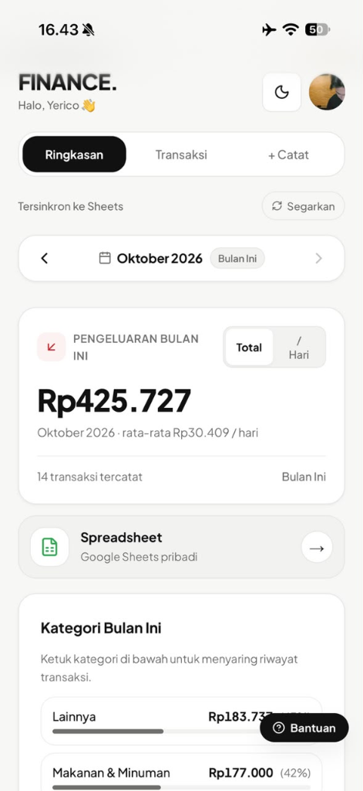
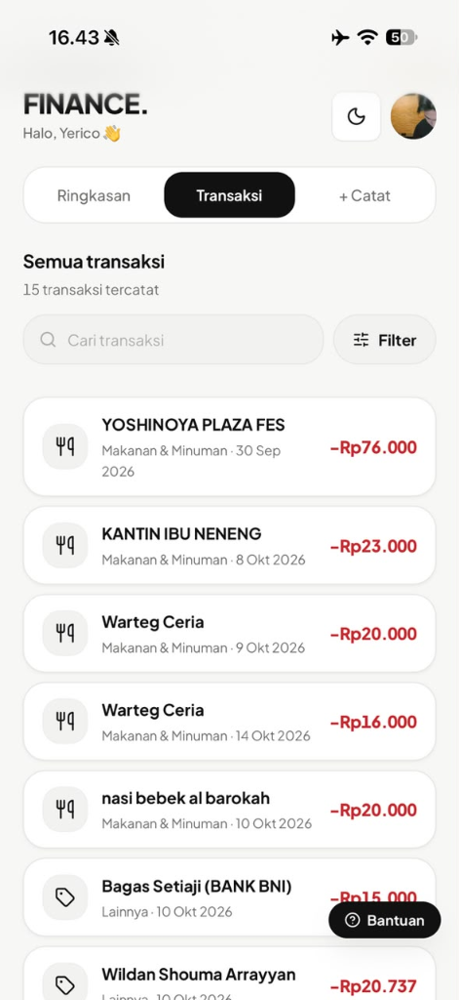
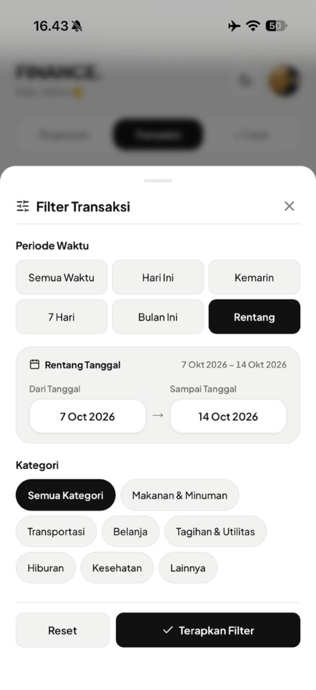
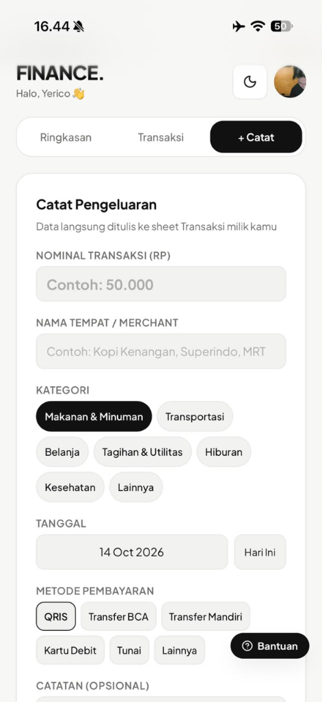
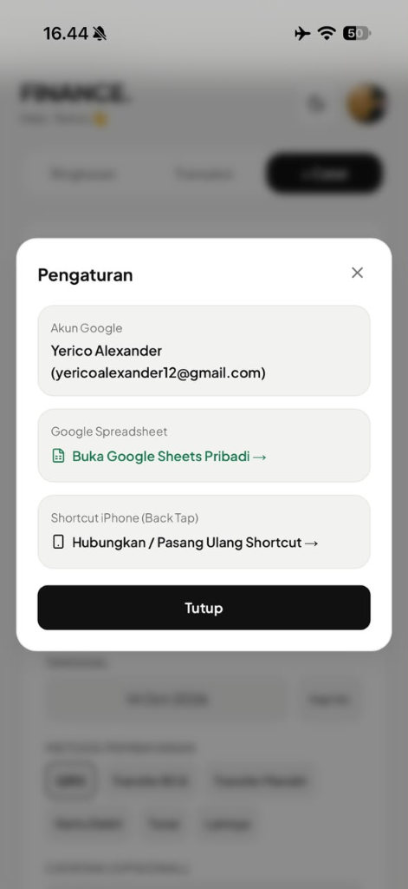
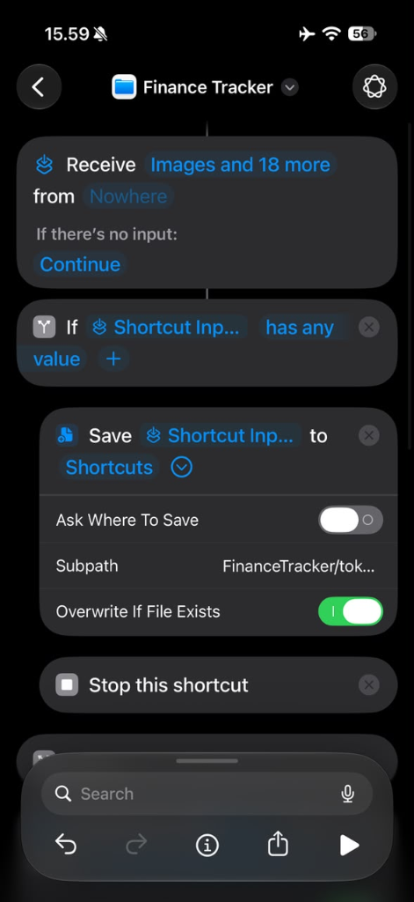
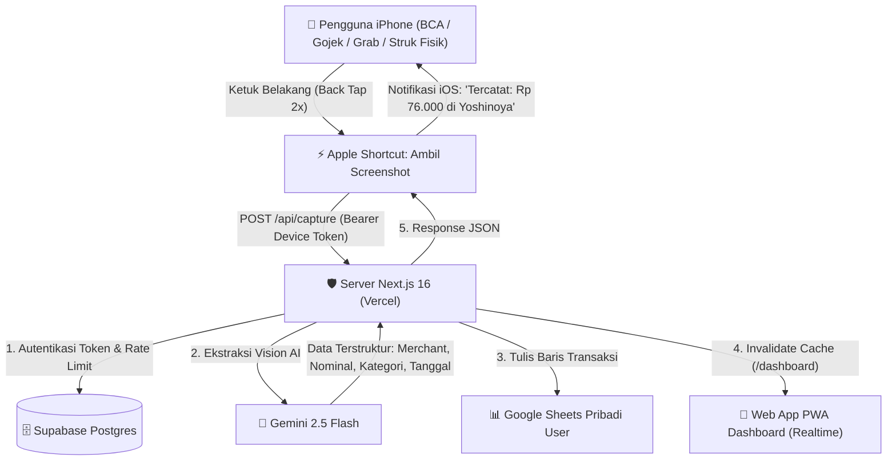

# 💸 Finance Tracker

> **Pencatatan pengeluaran instan dan otomatis dari tangkapan layar iPhone langsung ke Google Sheets pribadi & dashboard PWA Anda — didukung Gemini Vision AI dan Apple Shortcuts Back Tap.**

[](https://nextjs.org/)
[](https://www.typescriptlang.org/)
[](https://supabase.com/)
[](https://orm.drizzle.team/)
[](https://developers.google.com/sheets/api)
[](https://deepmind.google/technologies/gemini/)
[](https://vitest.dev/)

---

## 📱 Tampilan Antarmuka Aplikasi (UI Showcase)

<div align="center">

| 📊 Ringkasan Bulanan | ⚡ Riwayat Transaksi | 🔍 Filter & Rentang Tanggal |
| :---: | :---: | :---: |
|  |  |  |
| *Total MTD, rata-rata /hari, & kategori* | *Status transaksi realtime & badge [Baru]* | *Filter multi-kategori & rentang tanggal* |

<br/>

| ✍️ Catat Pengeluaran Manual | ⚙️ Pengaturan & Google Sheet | 🍎 Apple Shortcut Back Tap |
| :---: | :---: | :---: |
|  |  |  |
| *Input pengeluaran tanpa struk* | *Akses spreadsheet & pairing ulang* | *Pintasan otomatis membaca token* |

</div>

---

## ⚡ Alur Kerja & Arsitektur



---

## ✨ Fitur Unggulan

- ⚡ **Pembaruan Instan & Realtime**: Dilengkapi mekanisme *Fast Burst* pada saat kembali membuka aplikasi (0s, 1.5s, 3.5s) dan polling 4 detik saat tab aktif. 0% boros baterai saat layar mati.
- 📸 **iOS Back Tap Otomatis**: Cukup ketuk bagian belakang iPhone 2x pada layar pembayaran apa pun (QRIS, m-banking, invoice marketplace, struk kasir).
- 🧠 **Gemini 2.5 Flash Vision**: Ekstraksi pintar mengenali format rupiah Indonesia (`Rp 76.000`, `15rb`, `1,2 jt`), tanggal transaksi, nama merchant, dan kategori pengeluaran secara terstruktur.
- 📑 **Google Sheets Otomatis Milik Pengguna**: Saat login pertama via Google OAuth, spreadsheet baru otomatis dibuat di Google Drive masing-masing pengguna dengan rumus ringkasan interaktif.
- 🔐 **Keamanan & Privasi Maksimal**:
  - Token Google OAuth dienkripsi menggunakan **AES-256-GCM**.
  - Token perangkat iPhone disimpan dalam format **SHA-256 hash**.
  - Tangkapan layar diproses secara *in-memory* (RAM) dan **TIDAK PERNAH** disimpan ke disk/server.
  - Scope Google OAuth dibatasi hanya pada `drive.file` (hanya dapat mengakses spreadsheet yang dibuat oleh aplikasi ini).
- 🗓️ **Month Navigator**: Navigasi antar bulan (September, Oktober, dst.) instan dengan sinkronisasi reaktif data ringkasan.
- 🌓 **Mode Gelap / Terang**: Mendukung dark mode modern dengan desain mobile-first dan tipografi tabular angka uang.

---

## 🛠️ Tech Stack

- **Framework**: [Next.js 16 (App Router & Turbopack)](https://nextjs.org/)
- **Bahasa**: [TypeScript 5 (Strict Mode)](https://www.typescriptlang.org/)
- **Styling**: [Tailwind CSS 4](https://tailwindcss.com/) + CSS Design Tokens
- **Autentikasi**: [Auth.js (NextAuth v5 beta)](https://authjs.dev/) dengan Google Provider
- **Database**: [Supabase Postgres](https://supabase.com/) via Transaction Pooler
- **ORM**: [Drizzle ORM](https://orm.drizzle.team/)
- **Model Vision AI**: [Google Gemini 2.5 Flash API](https://ai.google.dev/)
- **Sheets Integration**: [Google APIs Node.js Client (`googleapis`)](https://github.com/googleapis/google-api-nodejs-client)
- **Kriptografi**: Node.js Native `crypto` (`aes-256-gcm` & `sha256`)
- **Testing**: [Vitest](https://vitest.dev/) (60 Unit & Integration Tests)

---

## 🚀 Memulai Proyek Secara Lokal

### 1. Prasyarat
- Node.js versi 20 atau lebih baru (`node -v`)
- Akun Google Cloud dengan Google Sheets API & Google Drive API aktif
- Database PostgreSQL (Supabase / Neon)

### 2. Kloning & Instalasi
```bash
git clone https://github.com/yericoalexander/finance-tracker.git
cd finance-tracker
npm install
```

### 3. Konfigurasi Lingkungan (`.env`)
Salin file `.env.example` ke `.env`:
```bash
cp .env.example .env
```

Isi variabel-variabel berikut di `.env`:
```env
# Database PostgreSQL
DATABASE_URL="postgresql://postgres:[PASSWORD]@[HOST]:6543/postgres"

# Auth.js
NEXTAUTH_SECRET="your-32-byte-base64-secret"
NEXTAUTH_URL="http://localhost:3000"

# Google OAuth Credentials
GOOGLE_CLIENT_ID="your-google-client-id.apps.googleusercontent.com"
GOOGLE_CLIENT_SECRET="your-google-client-secret"

# Kunci Enkripsi AES-256-GCM (64 karakter hex = 32 byte)
ENCRYPTION_KEY="your-64-character-hex-encryption-key"

# Gemini AI API Key
GEMINI_API_KEY="your-gemini-api-key"
GEMINI_MODEL="gemini-2.5-flash"

# Shortcut iCloud URL Resmi
NEXT_PUBLIC_SHORTCUT_ICLOUD_URL="https://www.icloud.com/shortcuts/4d6a9040bd104b02b91f2a198b0d8bef"
```

### 4. Push Skema Database
```bash
npm run db:push
```

### 5. Jalankan Server Development
```bash
npm run dev
```
Buka browser di [http://localhost:3000](http://localhost:3000).

---

## 🧪 Skrip & Pengujian

Semua fitur diuji dengan cakupan ketat untuk parser nominal, tanggal, skema ekstraksi AI, enkripsi AES-256-GCM, dan integrasi API:

```bash
# Menjalankan seluruh tes unit & integrasi
npm test

# Menjalankan linter ESLint
npm run lint

# Menjalankan verifikasi tipe TypeScript
npm run typecheck

# Membangun bundle produksi
npm run build
```

---

## 📂 Struktur Direktori Proyek

Proyek ini dibangun dengan arsitektur berbasis fitur (*feature-based*):

```text
finance-tracker/
├── .agent/                   # Aturan & skills asisten AI
├── drizzle/                  # Riwayat migrasi database SQL
├── public/                   # Ikon PWA & manifest web
├── src/
│   ├── app/                  # Next.js App Router (Rute & Endpoint API)
│   │   ├── api/
│   │   │   ├── auth/         # Handler NextAuth OAuth
│   │   │   ├── capture/      # POST /api/capture (Terima screenshot struk)
│   │   │   ├── devices/      # Pairing perangkat iOS
│   │   │   └── sheets/       # Endpoint segarkan formula sheets
│   │   ├── dashboard/        # Halaman dashboard utama
│   │   ├── login/            # Halaman masuk via Google
│   │   ├── pair/             # Halaman pairing & panduan Shortcut
│   │   ├── globals.css       # Design tokens & CSS variables
│   │   └── layout.tsx        # Root layout & tema
│   ├── features/             # Komponen & server actions per fitur
│   │   ├── auth/             # Konfigurasi NextAuth
│   │   ├── dashboard/        # Kartu ringkasan, navigator bulan, transaksi
│   │   ├── devices/          # Setup gate, banner pairing, modal onboarding
│   │   └── sheets/           # Retry & refresh kartu Google Sheets
│   ├── lib/                  # Utilitas bersama
│   │   ├── ai/               # Ekstraksi Gemini Vision & currency parser
│   │   ├── crypto/           # AES-256-GCM enkripsi refresh token
│   │   ├── db/               # Klien Drizzle ORM & skema PostgreSQL
│   │   ├── env.ts            # Validasi Zod variabel lingkungan
│   │   ├── google/           # Klien Google Sheets v4 & Drive API
│   │   └── security/         # Validasi Magic Bytes gambar & rate limit
│   └── middleware.ts         # Proteksi rute & autentikasi sesi
└── vitest.config.ts          # Konfigurasi runner Vitest
```

---

## 📲 Panduan Pemasangan Shortcut iOS (Apple Shortcuts)

1. **Unduh Shortcut Resmi**:
   Buka tautan [Finance Tracker Shortcut iCloud](https://www.icloud.com/shortcuts/4d6a9040bd104b02b91f2a198b0d8bef) di Safari iPhone Anda dan tap **Dapatkan Pintasan / Add Shortcut**.
2. **Koneksi 1-Klik**:
   Di dashboard aplikasi, tap tombol **"⚡ Hubungkan Otomatis ke iPhone"**. Shortcut akan terbuka otomatis dan menyimpan token otorisasi ke folder `FinanceTracker/token.txt` di iCloud Drive iPhone Anda.
3. **Aktifkan Back Tap**:
   - Buka **Pengaturan (Settings)** iPhone.
   - Pilih **Aksesibilitas (Accessibility)** > **Sentuh (Touch)**.
   - Gulir ke bawah dan pilih **Ketuk Bagian Belakang (Back Tap)**.
   - Pilih **Ketuk Dua Kali (Double Tap)** > cari dan pilih **Finance Tracker**.
4. **Selesai!** Setiap kali Anda mengetuk punggung iPhone 2x pada bukti transaksi, pengeluaran Anda akan tercatat seketika di Google Sheets & dashboard.

---

## 📄 Lisensi

Didistribusikan di bawah lisensi MIT. Hak cipta © 2026 Yerico Alexander.
